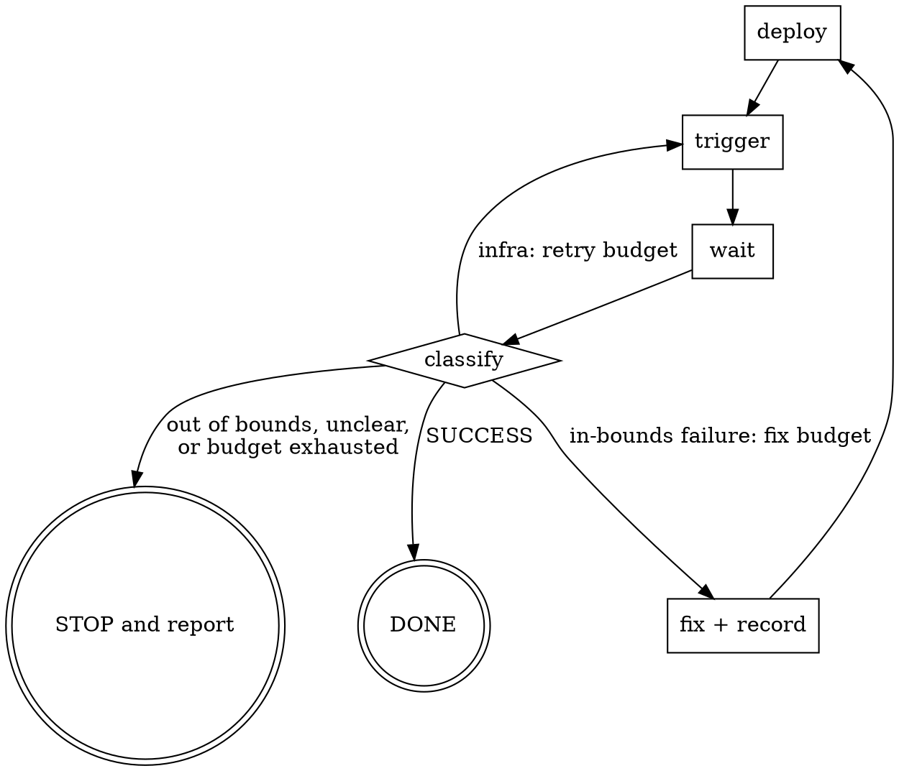

# DAB Autopilot

## Overview

Drive a Databricks Asset Bundle to a green run using the `databricks` CLI. Trigger, wait, classify the failure, fix it, redeploy, repeat.

**Core principle**, two independent budgets:
- Infrastructure failures cost a retry and requires no changes. This will typically be a GPU capacity issue.
- Real failures cost a fix attempt and require a code change. 

## When to Use

- Getting a DAB deployed and running, or a specific subset of its tasks
- A job run failed and needs diagnosis from its tracebacks
- Iterating on task code where each cycle needs a redeploy
- Completing a set of tasks with different configs - e.g multiple training runs with different hyperparameters.

Do NOT use for: authoring a bundle from scratch, Databricks workspace administration, or a repo with no `databricks.yml`.

## Budgets


| Budget | Limit | Spent when | 
|---|---|---|
| Fix attempts | 3 | You change code, config, or deps and redeploy | 
| Infra retries | 10 | You re-trigger an unchanged run after an infra failure | 

Exhausting either budget means STOP and report. Do not raise a budget on your own initiative; ask. No retries have a backoff, you should re-try immediately.

## Preflight

- Ask the user for the job key, target, and profile. Do not guess them. Write them down as `KEY`, `TARGET`, `PROFILE` and pass `-t TARGET -p PROFILE` on every command below.
- When the user names KEY and TARGET, they confirm the run, including any tables the job writes. Do not inspect the job for writes or ask again. The data limits in "In Bounds vs Stop" apply to your fixes, not to the job.
- Ask the user if `databricks bundle deploy` needs to be run before start, if so, ensure that it is run. A bundle never deployed to TARGET has no job id, so do this before the summary check.
- Run `databricks bundle summary -t TARGET -p PROFILE -o json | jq --arg key KEY '.resources.jobs[$key] | {id, name, tasks: [.tasks[].task_key]}'`. It must return a job id and task list. If it errors or returns null, STOP and report — do not guess.
- If task uses a multi-GPU setup, ask user if the instance size can be reduced (i.e g5.48xlarge -> g5.12xlarge), and after how many infra attempts this change should be made. Never make this change unless the user has specifically allowed you to do so.
- Ask the user if fixes may be redeployed and re-run against TARGET without confirmation. A fix can change the values the job writes. If not, wait for the user to approve each redeploy. Infra retries change no code and need no approval.


## The Loop



Note the infra edge returns to **trigger**, not deploy. Nothing changed, so there is nothing to redeploy.

## Commands

`bundle` commands take `-t TARGET -p PROFILE`. They are left out below for brevity — never leave them out when you run a command. `jobs` commands take `-p PROFILE`, shown below. A wrong profile looks up the run_id in another workspace.

```bash
# deploy bundle to target
databricks bundle deploy

# trigger, then wait to terminal — background this
databricks bundle run KEY --only a,b --params k=v

# trigger and exit, no waiting
databricks bundle run KEY --no-wait --only a,b

# task keys to repair: failed tasks plus the dependents they blocked (UPSTREAM_*). Tasks left out by --only are DISABLED/EXCLUDED, so they stay out
# (result_state is deprecated but is the field that tells FAILED from UPSTREAM_FAILED and DISABLED)
databricks jobs get-run <run_id> -p PROFILE -o json | jq -c '[.tasks[] | select(.state.result_state | IN("FAILED", "TIMEDOUT", "CANCELED", "UPSTREAM_FAILED", "UPSTREAM_CANCELED")) | .task_key]'

# latest repair id: needed from the second repair of a run on (empty on the first)
databricks jobs get-run <run_id> -p PROFILE --include-history -o json | jq '[.repair_history[]? | select(.type == "REPAIR") | .id] | last'

# repair those tasks inside the same run, wait to terminal. run_id goes in --json, not as an argument.
# Never set rerun_dependent_tasks: it also re-runs tasks that --only left out.
databricks jobs repair-run -p PROFILE --json '{"run_id":<run_id>,"rerun_tasks":["a","b"]}' --timeout 24h
# second repair on: add "latest_repair_id":<id> to the --json

# run state + per-task state (tasks left out by --only show as DISABLED or EXCLUDED; drop them)
databricks jobs get-run <run_id> -p PROFILE -o json | jq '{status, tasks: [.tasks[] | select(.status.termination_details.code != "DISABLED" and .state.result_state != "EXCLUDED") | {task_key, run_id, status}]}'

# one task's error and error_trace — use the task's run_id, not the parent run_id
databricks jobs get-run-output <task_run_id> -p PROFILE -o json | jq '{state: .metadata.state, error, error_trace}'
```

`--only` takes a comma-separated list in topological order. Omit it to run every task.

`get-run-output` only accepts a **task** run_id. Get each task's run_id from `get-run` first. Do not dump the full `get-run` JSON — it is large. Use `jq` to keep only what you need.

**Record the run_id in your first message after triggering.** The run continues on Databricks whether or not this session survives; the run_id is the only state needed to reattach. Losing it means losing track of a live run.

## Waiting

Never block a foreground call waiting for a run — they take minutes to hours. There is no automatic
sleep, and a foreground `sleep` is unavailable.

`databricks bundle run` (without `--no-wait`) already waits until the run is terminal. Do not
rebuild that loop. Run it in the background and let its exit be the wake-up:

```
Bash(run_in_background: true): databricks bundle run KEY -t TARGET -p PROFILE --only a,b
```

The harness wakes you when the process exits, so the loop continues without needing a user turn.

`databricks jobs repair-run` (the `--json` form in Commands) also waits to terminal by default (`--timeout` is 20m, so set a
longer one). Run it the same way, with `run_in_background`. A repair keeps the same run_id and adds a
repair_id, so keep the run_id you already have. Its exit is the wake-up. Use the `Monitor` loop below
only if the background process dies.

**Use the `run_in_background` parameter. Never background the command yourself** with `nohup`, a
trailing `&`, `disown`, `setsid`, or `screen`. A process you detach is not a harness task, so no
notification arrives when it exits, and you fall back to polling a log file — slower, and it burns
context on each check. A prefixed command such as `nohup databricks bundle run ...` also fails to
match the skill's `Bash(databricks *)` grant, so it raises a permission prompt and stalls an
unattended loop.

Read the background output file as soon as it exists: `bundle run` prints `Run URL: .../run/<run_id>`
before it starts to wait, which is how you capture the run_id while the run is still going. On wake,
call `databricks jobs get-run <run_id>` for the terminal state, then `get-run-output` per failed task
for tracebacks.

Never trust the exit code of `bundle run` as the result. Read the state from `get-run`.

**Never re-trigger to "reattach".** `bundle run` always starts a new run. If the background process
dies (timeout, lost auth or network) while the run is still `RUNNING`, wait on the existing run_id
with `Monitor` and an until-loop:

```bash
until databricks jobs get-run <run_id> -p PROFILE -o json | jq -e '.status.state == "TERMINATED" or .status.state == "INTERNAL_ERROR" or .status.state == "SKIPPED"' >/dev/null; do sleep 60; done
```

The run itself is unaffected — it lives on Databricks, not in this shell.

Treat a run as finished only when `status.state` is terminal (`TERMINATED`, `INTERNAL_ERROR`, `SKIPPED`).

## Classification

Read `status.termination_details.code` from `get-run`, plus every task's `status` from `get-run` and `error` and `error_trace` from `get-run-output`.

| Signal | Class | Action |
|---|---|---|
| The parent run is `SUCCESS` and every selected task is `SUCCESS` | done | Report and stop |
| `RESOURCE_NOT_AVAILABLE`, or capacity/quota/"no available" language in `termination_details.message` | infra | Re-trigger unchanged, spend a retry |
| `PERMISSION_DENIED`, `INSUFFICIENT_PERMISSIONS`, "User does not have", credential, catalog or workspace access denied | access | STOP and report |
| `TABLE_OR_VIEW_NOT_FOUND`, `AnalysisException` for a missing table or column, unexpected schema, empty input | data | STOP and report |
| `ImportError`, `ModuleNotFoundError`, version conflict, wheel build failure | deps | Fix packaging, spend a fix |
| Task wiring, missing param, bad dependency order, cluster/env config | config | Fix bundle definition, spend a fix |
| Python traceback in `error_trace` with none of the signals above | code | Fix source, spend a fix |
| Anything you cannot confidently place above | unknown | STOP and report |

If the run is not done, classify each failed task on its own. A successful task is not a signal. Check rows top to bottom and take the first match. Spark and Python tasks wrap data and access errors in a Python traceback, so a traceback is a code failure only when no access or data signal is in it.

When several tasks fail, fix the earliest failure in dependency order first — downstream failures are usually consequences.

## Multi-Task Runs

A multi-task run is one run of several tasks, e.g. `--only task_A,task_B`. Tasks complete
independently, so a later task can fail after an earlier task succeeds.

**A new `bundle run` is a new job run.** It cannot read task values or outputs from an earlier run.
If you start it with only the failed task and later tasks, the upstream tasks do not run in it, and
the failed task fails again or reads stale data.

To re-run only the failed tasks and keep the successful ones, repair the original run with
`databricks jobs repair-run -p PROFILE --json '{"run_id":<run_id>,"rerun_tasks":[...]}'`. Put
`run_id` in `--json`, never as an argument. A repair re-runs tasks inside that run, with the current job and task
settings (Databricks docs). So a redeploy before the repair is picked up. The run must not be in
progress. Put the failed tasks and the dependents they blocked in `rerun_tasks`, using the jq line in Commands. Do not use `rerun_dependent_tasks` or `--rerun-all-failed-tasks`. From the second repair of a run on, pass `latest_repair_id`, or the repair fails.

| Situation | Action |
|---|---|
| Infra failure | `repair-run` the original run. Nothing changed, so completed output stays valid. |
| Fix touches only the failed task's code | Redeploy, then `repair-run` the original run. |
| Fix touches code a completed task also runs | New `bundle run` with the full original `--only` list. |
| `repair-run` cannot be used | New `bundle run` with the full original `--only` list. Never only the failed tail. |

The third row is the one that is easy to miss. A completed task's output comes from the code that
was deployed when it ran. If your fix changes a shared module, the wheel, or a job cluster that the
completed task also uses, that output is now stale. Re-run the full list.

Keep the tasks in topological order, as `--only` requires.

Report the run_id of the original run, and the repair_id if you repaired it (`repair_history` in
`get-run --include-history`). A repaired run is green only when `get-run` shows every selected task as `SUCCESS`. Never
call the whole list green from a run that did not include all of it.

## Sweeps

A sweep is several runs of the same tasks with different configurations, e.g. one run per hyperparameter set.

Run configs **one at a time, in the given order**. The first config is a canary for the shared code: if it fails for a real reason, every later config would hit the same bug, so fixing before proceeding is cheaper than discovering it N times.

| Rule | Behaviour |
|---|---|
| Order | Sequential. Never trigger the next config before the current one is terminal. |
| Fix budget | **Global — 3 across the whole sweep.** A code fix changes shared code, so it isn't per-config. |
| Infra retries | **Per config — 10 each.** Each config independently rolls the dice on capacity. |
| Real failure | Halt the sweep. Fix, then re-run the config that failed before moving on. |
| Infra failure | Not a halt. Retry that config; the sweep is still on track. |

Write down the full config list and each config's run_id and outcome as you go. Report the sweep as a table of config → run_id → outcome, including configs never reached and why.

If a config fails for a reason specific to its own params rather than the shared code — an out-of-range value, an invalid combination — say so explicitly when you halt. That distinction tells the user whether their sweep definition or their code is wrong.

## In Bounds vs Stop

**Fix autonomously:** task source code, the bundle definition, dependency and packaging files.

**Always STOP and report, never fix:** a fix that writes to data or tables itself, or changes where or how the job writes (see below), anything needing a credential or permission change, and anything where your diagnosis is a guess.

These limits apply to the fixes you make, not to the job. The user asked for the run, so the job's own reads and writes are in bounds.

A fix that changes the values the job writes is in bounds. A fix that changes where or how the job writes is not: the target table or path, the output schema, the write mode (e.g. append to overwrite), or delete, overwrite or merge logic. STOP and report.

Before each redeploy, state in one or two lines: what failed, what you changed, and why that addresses it. If the user did not allow unconfirmed fixes in preflight, wait for their approval before you deploy.

## Red Flags — STOP and Report

- About to spend a fix attempt without having read the `error_trace`
- About to apply the same fix a second time
- About to write to a table, grant a permission, or edit credentials to make a run pass
- About to raise a budget, or "just one more" past a limit
- About to declare success without a terminal `SUCCESS` in `get-run` output
- Reaching for a data fix because the code fix isn't obvious
- About to trigger a sweep's next config before the current one is terminal

## Rationalizations

| Excuse | Reality |
|---|---|
| "The GPU retries are failures too, count them as fixes" | Infra failures carry no diagnostic signal. Separate budgets exist precisely so capacity misses can't mask real bugs. |
| "It's probably the same root cause, I'll fix it blind" | Read the traceback. A fix attempt without evidence is a guess that burns a third of the budget. |
| "I'll just backfill the missing table so it runs" | Writing data is out of bounds. Report the missing upstream and stop. |
| "One more attempt and it'll pass" | The cap is the cap. Report where it stands and let the user decide. |
| "The last run failed but only in a flaky task, close enough" | Green means terminal SUCCESS. Nothing else is done. |
| "Deploy is slow, I'll skip it after this edit" | An unrebuilt bundle runs the old code. Every code change needs a deploy. |
| "I'll `nohup` it so the run survives" | The run already survives — it lives on Databricks, not in this shell. Detaching only costs you the wake-up notification. Use `run_in_background`. |
| "I'll `bundle run --only` just the failed task and the ones after it" | A new run has no upstream tasks, so it cannot read their task values or outputs. Use `repair-run` on the original run, or re-run the full original list. |
| "Firing the whole sweep at once is far quicker" | Sequential is the rule. Parallel configs multiply a shared bug across every run and compete for the capacity you're already short of. |
| "This config's failure is unrelated, I'll keep the sweep going" | A real failure halts the sweep. If it truly is config-specific, say so when you halt and let the user decide. |

## Reporting

On exit — green, exhausted, or out of bounds — report the final run_id, the terminal state, what was changed across iterations, and what remains if it isn't green. Say plainly that a run failed when it failed.
